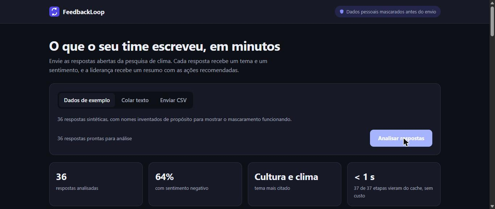
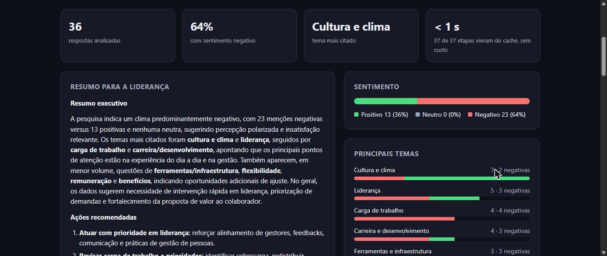
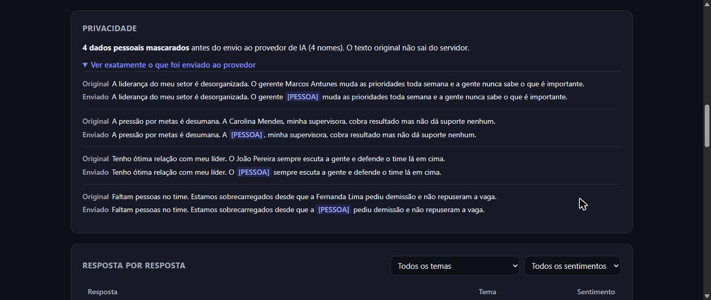
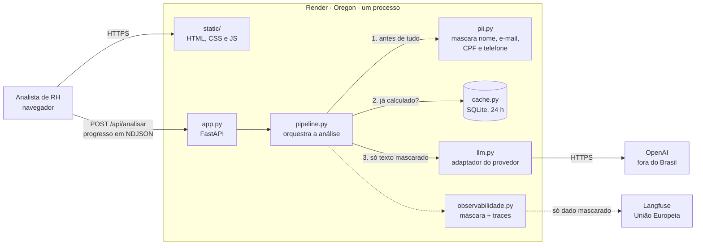

# FeedbackLoop — Survey Insights

Análise em lote de respostas abertas de pesquisa de clima. Classifica tema e
sentimento de cada resposta e devolve um resumo executivo com ações recomendadas.
Os dados pessoais são mascarados antes de qualquer envio ao provedor de LLM.

**Aplicação no ar:** https://feedbackloop-prod.onrender.com

[](https://github.com/brunoleao95/feedbackloop-survey-insights/actions/workflows/ci-cd.yml)
[](https://github.com/brunoleao95/feedbackloop-survey-insights/actions/workflows/monitor.yml)

**Observabilidade, sem login:**
[um trace real de produção no Langfuse](https://cloud.langfuse.com/project/cmvazqcvr01hfad0kifd23oag/traces/16aadd310862ab953ccc90815bbdbaf7),
com as 37 chamadas ao modelo, latência, custo e os nomes já substituídos por
`[PESSOA]`.

## Sumário

- [O problema e a solução](#o-problema-e-a-solução)
- [Capturas de tela](#capturas-de-tela)
- [Arquitetura](#arquitetura)
- [Stack](#stack)
- [Como rodar](#como-rodar)
- [Variáveis de ambiente](#variáveis-de-ambiente)
- [Deploy](#deploy)
- [Operação](#operação)
- [Otimizações](#otimizações)
- [Troubleshooting](#troubleshooting)
- [LGPD](#lgpd)
- [Limitações conhecidas](#limitações-conhecidas)
- [Documentação](#documentação)
- [Como contribuir](#como-contribuir)
- [Licença](#licença)
- [Autores](#autores)

## O problema e a solução

Pesquisas de clima têm duas metades. As perguntas fechadas qualquer ferramenta
agrega. As abertas, onde a pessoa escreve o que realmente pensa, ninguém consegue
ler: uma pesquisa média gera de centenas a milhares de respostas em texto livre,
e o analista de RH passa dias lendo comentário por comentário.

O sistema recebe as respostas por CSV ou texto colado e devolve, em uma passada:

1. **Tema** de cada resposta, agregado e contado
2. **Sentimento** de cada resposta: positivo, neutro ou negativo
3. **Resumo executivo** com leitura do cenário e ações recomendadas

Os números do resumo são calculados em código, não pedidos ao modelo. Só o texto
qualitativo vem do LLM: modelo de linguagem erra conta, e contagem de tema é
exatamente o que o cliente compra.

Os temas vêm de uma **lista fixa de 11 temas**, e não da criatividade do modelo:
com o tema em aberto, 36 respostas viravam 23 temas; com a lista, viram 11.

Com as 36 respostas de exemplo, uma análise custa **US$ 0,014** e leva de 30 a
55 segundos, com o andamento visível na tela. Repetida dentro de 24 horas, custa
**zero** e volta em menos de um segundo.

## Capturas de tela

Produção, com as 36 respostas de exemplo.

**Entrada e indicadores.** Dados de exemplo, texto colado ou CSV arrastado.



**Resultado.** Resumo para a liderança, distribuição de sentimento e, em cada
tema, quantas respostas são negativas.



**Privacidade.** O analista confere, resposta por resposta, o que saiu do
servidor: os nomes chegam ao provedor como `[PESSOA]`.



## Arquitetura



Um único serviço, sem banco de dados. A ordem dentro do pipeline é a garantia de
LGPD: nada chega ao `llm.py` sem passar pelo `pii.py`, e um teste com um cliente
espião falha se qualquer nome de exemplo chegar ao provedor. O adaptador é o
único ponto do código que conhece a OpenAI, o que permite testar tudo sem rede.
Diagramas C4 em [`docs/architecture/`](docs/architecture/c4-contexto-e-containers.md).

## Stack

| Camada | Escolha | Por quê |
|---|---|---|
| Linguagem | Python 3.13.2, fixado em `.python-version` | Ver [ADR-001](docs/adr/adr-001-adocao-da-stack-b.md) |
| Servidor | FastAPI 0.115 com uvicorn 0.34 | API pequena e resposta em streaming. Ver [ADR-004](docs/adr/adr-004-interface-web-com-fastapi.md) |
| Interface | HTML, CSS e JavaScript, sem framework | Uma página só, sem build e sem dependência externa |
| LLM | OpenAI, modelo `gpt-5.4-mini`, SDK 1.50 com `httpx` 0.27.2 fixado | O adaptador em `feedbackloop/llm.py` é o único ponto que conhece o provedor |
| Observabilidade | Langfuse Cloud, região UE, SDK 5.0.2 | Ver [ADR-003](docs/adr/adr-003-observabilidade-com-langfuse.md) |
| Cache | SQLite, da biblioteca padrão | Sem serviço a mais. Ver [a otimização](docs/otimizacao/cache.md) |
| Hospedagem | Render, Oregon | Ver [ADR-002](docs/adr/adr-002-hospedagem-no-render.md) |
| CI/CD e alerta | GitHub Actions | Pipeline de publicação e monitor de produção |

Todas as dependências, inclusive as transitivas que já quebraram o sistema uma
vez, estão fixadas em `requirements.txt` com o motivo ao lado. O protótipo
herdado usava Streamlit; a troca está registrada no ADR-004.

## Como rodar

```bash
git clone https://github.com/brunoleao95/feedbackloop-survey-insights.git
cd feedbackloop-survey-insights
python -m venv .venv && source .venv/bin/activate   # Windows: .venv\Scripts\activate
pip install -r requirements.txt
cp .env.example .env                                # e preencha OPENAI_API_KEY
uvicorn app:app --reload
```

Abra http://127.0.0.1:8000. O `app.py` carrega o `.env` sozinho. Deixe "Dados de
exemplo" selecionado e clique em Analisar respostas. Sem a chave, a interface carrega e só a análise falha, com mensagem
explícita. Sem as chaves do Langfuse, a telemetria fica desligada e o resto
funciona igual.

**Testes offline**, 62, que não chamam a API e não custam nada:

```bash
pytest tests --ignore=tests/smoke -q
```

Cobrem o pipeline, a taxonomia de temas, a sanitização (incluindo um cliente
espião que falha se qualquer nome chegar ao provedor, pelo pacote e pela API), a
máscara da telemetria, a API web e o cache, com um relógio falso que avança 24
horas para provar que a exclusão apaga de fato.

**Smoke tests**, 5, contra o que está publicado:

```bash
SMOKE_URL=https://feedbackloop-prod.onrender.com pytest tests/smoke -v
```

## Variáveis de ambiente

| Nome | Obrigatória | Exemplo | Descrição |
|---|---|---|---|
| `OPENAI_API_KEY` | **Sim**, para analisar | `sk-...` | Chave da OpenAI. **Segredo.** Uma por ambiente |
| `LANGFUSE_PUBLIC_KEY` | Não | `pk-lf-...` | Chave pública do projeto no Langfuse. Sem o par, a telemetria fica desligada |
| `LANGFUSE_SECRET_KEY` | Não | `sk-lf-...` | Chave secreta do Langfuse. **Segredo** |
| `LANGFUSE_BASE_URL` | Não | `https://cloud.langfuse.com` | Região do projeto no Langfuse. Este projeto está na UE |
| `LANGFUSE_TRACING_ENVIRONMENT` | Não | `prod` | Rótulo do ambiente nos traces: `local`, `dev` ou `prod`. Padrão `local` |
| `CACHE_PATH` | Não | `/tmp/feedbackloop-cache.sqlite3` | Arquivo do cache. Padrão: diretório temporário do sistema |
| `CACHE_TTL_SEGUNDOS` | Não | `86400` | Prazo de retenção do cache. Padrão 24 horas. Não aumente sem revisar a [política de retenção](docs/lgpd/retencao-e-exclusao.md) |
| `SMOKE_URL` | Só nos smoke tests | `https://feedbackloop-dev.onrender.com` | Alvo dos smoke tests. Não é lida pela aplicação |

Localmente, os valores ficam no `.env`, que está no `.gitignore`. O
[`.env.example`](.env.example) documenta todas, sem nenhum valor real. Em dev e
produção, ficam no painel de cada serviço no Render, com valores diferentes por
ambiente: **dev e produção não compartilham nenhuma chave**. Inventário,
procedimento de rotação e auditoria do histórico do Git com `gitleaks` em
[`docs/seguranca/rotacao-de-credenciais.md`](docs/seguranca/rotacao-de-credenciais.md).

## Deploy

| Ambiente | Branch | URL | Plano |
|---|---|---|---|
| Produção | `main` | https://feedbackloop-prod.onrender.com | pago, não hiberna |
| Desenvolvimento | `dev` | https://feedbackloop-dev.onrender.com | gratuito, hiberna após 15 min |

O auto-deploy da plataforma está **desligado**. Quem publica é o pipeline em
`.github/workflows/ci-cd.yml`: um push, ou um disparo manual, roda os testes,
dispara o deploy pela API do Render, aguarda o serviço ficar no ar e roda os
smoke tests contra o que foi publicado. O ambiente de destino sai do nome da
branch. Leva cerca de 3 minutos.

Configuração de cada serviço no Render: build `pip install -r requirements.txt`,
start `uvicorn app:app --host 0.0.0.0 --port $PORT` e health check em `/saude`.
Com o health check, o Render só troca a versão no ar quando a nova responde.

Trabalho novo nasce na `dev`, é validado no ambiente de desenvolvimento e sobe
para a `main` por merge.

**Rollback:** pelo painel do Render, em *Deploys*, escolher o último deploy bom e
*Rollback*. No incidente de 29/08 levou 26 segundos. Depois, `git revert` do
commit que causou o problema, porque o rollback da plataforma não desfaz o commit.
Ver o [post-mortem](docs/post-mortem-2026-08-29.md).

## Operação

Cinco métricas, cada uma com linha de base medida e limite justificado. O
detalhe, com o porquê de cada número, está em
[`docs/operacao/metricas-e-alertas.md`](docs/operacao/metricas-e-alertas.md).

| Métrica | Linha de base | Limite |
|---|---|---|
| Latência por chamada | p50 1,05 s · p95 2,06 s · p99 3,38 s | p95 > 4 s (P3), > 8 s (P2) |
| Custo por análise | US$ 0,0138 (era 0,0088 antes da taxonomia) | > US$ 0,02 por análise ou > US$ 3,70 por dia (P2) |
| Erro | 0 em 111 chamadas | qualquer smoke test falhando (P1) · > 2% das chamadas ou > 5% fora do formato (P2) |
| Volume | 77 unidades do Langfuse por análise | 30 mil no mês, 60% da cota (P3) |
| Qualidade | formato válido 1,00 · pulverização 0,306 (era 0,639 antes da taxonomia) | formato < 0,95 (P2) · respostas em "Outros" acompanhadas |

**Alerta configurado (P1).** O workflow
[`monitor.yml`](.github/workflows/monitor.yml) roda os 5 smoke tests contra
produção. Se algum falha, abre uma issue com o rótulo `alerta-p1`, notificada
por e-mail. Se a falha persiste, comenta na mesma issue. A primeira verificação
que passa fecha a issue. Testado em 16/10/2026: apontado para um endereço que
não é a aplicação, abriu a issue #1; na execução seguinte, contra produção,
fechou.

**O alerta já pegou um problema real.** Em 07/11/2026, o GitHub não disparou o
pipeline de um merge na `main`, e produção ficou com o código antigo enquanto o
repositório já tinha o novo. O monitor rodou, os testes novos falharam contra a
versão antiga, e a issue #3 abriu. O deploy foi feito e a issue fechou sozinha
cinco minutos depois.

**Janela de uptime.** O monitor está configurado para cada 30 minutos, mas o
agendador do GitHub executou, na prática, a cada 4,5 horas em média, com
intervalo máximo de 10 horas. Entre 16/10 e 07/11 foram 115 verificações
agendadas. Desde 22/10, **todas passaram**. As 11 falhas de 20 a 22/10 foram do
executor do GitHub, que deixou de ter o Python do projeto, e não de produção. A
última indisponibilidade real de produção foi a de 29/08, com 4min47s. Produção
roda no plano pago e não hiberna.

**Painéis.**

| Painel | Onde |
|---|---|
| Latência, custo e uso | Langfuse, projeto FeedbackLoop, filtro `environment = prod` |
| Trace público de exemplo | [análise de 36 respostas em produção](https://cloud.langfuse.com/project/cmvazqcvr01hfad0kifd23oag/traces/16aadd310862ab953ccc90815bbdbaf7) |
| Memória e CPU | Render, serviço `feedbackloop-prod`, aba Metrics |
| Disponibilidade | [Actions, workflow *Monitor de producao*](https://github.com/brunoleao95/feedbackloop-survey-insights/actions/workflows/monitor.yml) |

Cada análise gera um trace com a árvore completa: a sanitização, cada
classificação e o resumo, e nos metadados as contagens de PII mascarada, a taxa
de formato válido, a pulverização de temas, a fração em "Outros" e a taxa de
acerto do cache.

## Otimizações

### 1. Cache das respostas do LLM

Prazo de 24 horas.
Detalhe em [`docs/otimizacao/cache.md`](docs/otimizacao/cache.md).

Medido em produção, nas mesmas 36 respostas, pelos traces do Langfuse:

| | Antes: sem cache | Depois: 1ª análise | **Depois: análise repetida** |
|---|---|---|---|
| Latência da análise | 37,5 s | 29,6 s | **0,003 s** |
| Chamadas ao provedor | 37 | 37 | **0** |
| Custo | US$ 0,0089 | US$ 0,0087 | **US$ 0** |
| Observações no Langfuse | 76 | 76 | **2** |

**O que estes números não dizem.** A primeira análise não ficou mais rápida por
causa do cache: a diferença é variação do provedor, que já oscilava de 34 s a
57 s. O ganho só existe quando a mesma planilha é analisada de novo.

**O trade-off.** O cache escolhe latência e custo, e paga em qualidade: o
resultado fica congelado por até 24 horas e o resumo deixa de variar entre
execuções. Uma falha de formato nunca é guardada, para não ser repetida. A chave
inclui o modelo e o prompt, então trocar qualquer um invalida o cache sozinho.

### 2. Taxonomia fixa de temas

Detalhe em [`docs/otimizacao/taxonomia-de-temas.md`](docs/otimizacao/taxonomia-de-temas.md).
Medido com o modelo real, nas mesmas 36 respostas:

| | Antes: tema em aberto | **Depois: lista de 11 temas** |
|---|---|---|
| Temas distintos | 23 | **11** |
| Respostas cobertas pelos 8 temas da tela | 23 de 36 | **31 de 36** |
| Custo por análise | US$ 0,0089 | US$ 0,0138 |

**O trade-off é o inverso do cache.** Aqui se paga custo para ganhar qualidade:
a lista de temas dobrou os tokens de entrada, e o custo subiu 56%. Ainda cabe
folgado no orçamento: US$ 113 por mês pagam cerca de 8 mil análises desse
tamanho. E menos temas não quer dizer temas certos: sem gabarito, o sistema mede
se a agregação ficou legível, não se cada classificação está correta.

## Troubleshooting

**1. A análise falha com erro de autenticação do provedor.**
`OPENAI_API_KEY` ausente, errada ou revogada. Localmente, confira o `.env`. No
Render, troque o valor no serviço e veja o item 2.

**2. Mudei uma variável no Render e nada mudou.**
Salvar variável no painel **não reinicia o processo**. É preciso disparar um
deploy: pelo painel, em *Manual Deploy*, ou por um novo push na branch.

**3. Nenhum trace aparece no Langfuse.**
Os nomes são exatos: `LANGFUSE_PUBLIC_KEY` e `LANGFUSE_SECRET_KEY`. Uma variável
chamada `LANGFUSE_API_KEY`, por exemplo, é ignorada sem erro. Confira também se
`LANGFUSE_BASE_URL` aponta para a região do projeto, e o item 2.

**4. Traces de produção aparecem com o ambiente `dev`.**
`LANGFUSE_TRACING_ENVIRONMENT` foi copiado de um serviço para o outro. É a única
variável que precisa ter valor diferente sem ser segredo. Corrija e faça o deploy.

**5. O ambiente de desenvolvimento demora quase um minuto para abrir.**
Esperado. O plano gratuito hiberna depois de 15 minutos sem acesso, e o primeiro
acesso acorda o serviço. Produção não hiberna.

**6. A análise fica lenta ou começa a falhar no meio.**
Provável limite de requisições por minuto do provedor (erro 429). Uma análise de
36 respostas faz cerca de 55 chamadas por minuto, e umas 9 análises simultâneas
esbarram no limite. Veja a métrica de erro nos traces e a página de status da
OpenAI.

**7. Reanalisei a planilha e o resultado veio idêntico, instantâneo.**
É o cache funcionando. A interface avisa quantas etapas vieram dele. Para forçar
uma análise nova, apague o arquivo em `CACHE_PATH` e reinicie o app. Em produção,
qualquer deploy esvazia o cache, porque o disco do serviço é efêmero.

**8. O deploy falha logo no início, com `uvicorn: command not found` ou `streamlit: command not found`.**
O Start Command do serviço no Render não bate com o código. Desde a 1.2.0 ele é
`uvicorn app:app --host 0.0.0.0 --port $PORT`. Ao trocar, mude o Start Command e
publique o código novo em seguida: salvar o comando não reinicia o processo,
mas qualquer reinício entre os dois passos derruba o site.

**9. O primeiro pipeline depois de mudar dependências demora uns 6 minutos.**
O build instala tudo sem cache de pacotes. Os seguintes voltam para cerca de 3
minutos. Não é falha, e o smoke test espera o serviço subir.

**10. Fiz merge na `main` e produção continua com a versão antiga.**
O GitHub pode não entregar o evento de push, e aí o pipeline não roda. Confira em
*Actions* se existe execução para o commit da `main`. Se não existir, rode o
workflow *CI/CD* manualmente na `main`: o disparo manual também publica. Foi o
que aconteceu em 07/11/2026, e o monitor pegou.

**11. Os workflows falham em "setup-python" sem rodar nenhum teste.**
O executor mudou de versão e não tem o Python do projeto. Os workflows usam
`ubuntu-24.04` fixo por isso; não troque por `ubuntu-latest`. Aconteceu entre 20
e 22/10/2026.

**12. Uma issue `alerta-p1` foi aberta.**
Siga o
[procedimento de resposta](docs/operacao/metricas-e-alertas.md#procedimento-de-resposta-ao-p1):
o nome do teste que falhou diz a camada do problema, e se a falha começou logo
depois de um deploy, o caminho mais rápido é o rollback.

## LGPD

**A FeedbackLoop é operadora.** A empresa cliente é a controladora dos dados dos
seus colaboradores. O tratamento se apoia no legítimo interesse, Art. 7º, IX, e
cada análise é uma transferência internacional, Art. 33, porque o provedor de LLM
processa fora do Brasil.

**O que o sistema faz para proteger o titular:**

- **Sanitização antes do LLM.** Nomes, e-mail, CPF e telefone são substituídos
  por `[PESSOA]`, `[EMAIL]`, `[CPF]` e `[TELEFONE]` em `feedbackloop/pii.py`,
  antes de qualquer chamada. Nas respostas de exemplo, os 4 nomes plantados são
  mascarados, sem falso positivo. A interface mostra ao analista exatamente o que
  foi enviado
- **Telemetria mascarada.** O cliente do Langfuse aplica a mesma sanitização, e
  mais um filtro de chaves de API, a tudo que exporta
- **Minimização.** Só a coluna `resposta` é lida. Nenhuma resposta é gravada em
  disco. O cache guarda só tema, sentimento e resumo, sob uma chave em hash
- **Retenção com mecanismo real.** O cache expira em 24 horas por um `DELETE` em
  SQL executado pelo próprio sistema, testado com relógio falso

**Documentos:** [mapa de dados pessoais](docs/lgpd/mapa-de-dados.md), com os 7
pontos de tratamento e a base legal de cada um, e
[política de retenção e exclusão](docs/lgpd/retencao-e-exclusao.md), com os 6
lugares onde algum dado existe, por quanto tempo e quem apaga.

**Riscos abertos, registrados nos documentos acima:** relato de saúde numa
resposta é dado sensível, Art. 11, que o legítimo interesse não cobre; e o
registro de acesso exigido pelo Marco Civil, Art. 15, é de 6 meses, enquanto o
plano atual do Render guarda 7 dias.

## Limitações conhecidas

O que já foi resolvido desde o protótipo: dado pessoal indo sem tratamento ao
provedor, ausência de observabilidade, ausência de cache, interface de protótipo
e temas inventados a cada resposta. O que continua aberto:

- **Não há gabarito de qualidade.** A taxonomia reduziu os temas de 23 para 11,
  mas o sistema não sabe se cada classificação está certa. O conjunto de
  validação pedido no briefing não foi construído
- **A lista de temas é fixa no código.** Um cliente com temas próprios exigiria
  mudar o código
- **A sanitização é por regra, não por modelo.** Nome escrito só em minúsculas,
  ou apelido, passa. O teste cobre os casos de exemplo, não todos os possíveis
- **Só o alerta P1 é automático.** Os limites de latência, custo e qualidade
  são verificados nos painéis
- **A análise é síncrona.** Com milhares de respostas, uma análise longa bloqueia
  a aplicação para outros visitantes
- **Nada é histórico.** O resultado pode ser baixado em CSV, mas o servidor não
  guarda análises, então não há comparação entre trimestres. O cache não
  substitui um histórico: ele expira e é esvaziado a cada deploy
- **O monitor não roda a cada 30 minutos.** O agendador do GitHub executou, em
  média, a cada 4,5 horas. Uma queda curta pode passar despercebida

As 36 respostas em `data/respostas-pesquisa-exemplo.csv` são **sintéticas**, com
nomes inventados de propósito. Leia
[`data/AVISO-DADOS-SINTETICOS.md`](data/AVISO-DADOS-SINTETICOS.md) antes de
substituí-las.

## Documentação

| Documento | Conteúdo |
|---|---|
| [Auditoria do protótipo](docs/auditoria-prototipo.md) | O que foi herdado, com evidência em arquivo e linha |
| [Matriz de decisão de stack](docs/matriz-decisao-stack.md) | Critérios e pesos, definidos antes das notas |
| [ADR-001](docs/adr/adr-001-adocao-da-stack-b.md) | Adoção da stack |
| [ADR-002](docs/adr/adr-002-hospedagem-no-render.md) | Hospedagem e a divisão entre pago e gratuito |
| [ADR-003](docs/adr/adr-003-observabilidade-com-langfuse.md) | Observabilidade com Langfuse |
| [ADR-004](docs/adr/adr-004-interface-web-com-fastapi.md) | Interface web própria com FastAPI |
| [Diagramas C4](docs/architecture/c4-contexto-e-containers.md) | Contexto, contêineres e componentes |
| [Mapa de dados pessoais](docs/lgpd/mapa-de-dados.md) | Pontos de tratamento e base legal |
| [Retenção e exclusão](docs/lgpd/retencao-e-exclusao.md) | Onde cada dado existe e quem apaga |
| [Rotação de credenciais](docs/seguranca/rotacao-de-credenciais.md) | Inventário, procedimento e auditoria do histórico |
| [Métricas e alertas](docs/operacao/metricas-e-alertas.md) | Linha de base, limites, alerta P1 e painéis |
| [Otimização com cache](docs/otimizacao/cache.md) | Antes e depois, trade-off e como reproduzir |
| [Taxonomia de temas](docs/otimizacao/taxonomia-de-temas.md) | 23 temas viram 11, e o custo disso |
| [Post-mortem 29/08](docs/post-mortem-2026-08-29.md) | Indisponibilidade de 4min47s e o rollback |
| [CHANGELOG](CHANGELOG.md) | Histórico de versões |

## Como contribuir

1. Crie a branch a partir da `dev`
2. Rode `pytest tests --ignore=tests/smoke -q` antes de abrir o PR
3. Abra o PR para a `dev`. O pipeline publica no ambiente de desenvolvimento
4. Depois de validar em dev, a `dev` sobe para a `main` por merge
5. Nunca commite `.env` nem valor de chave. Variável nova entra no `.env.example`
   e na tabela de variáveis acima
6. Mudança que passe a guardar qualquer dado, ou que altere o que vai para o
   provedor, atualiza também o [mapa de dados](docs/lgpd/mapa-de-dados.md) e a
   [política de retenção](docs/lgpd/retencao-e-exclusao.md)

O histórico segue o [Keep a Changelog](https://keepachangelog.com/pt-BR/1.1.0/) e
o [Versionamento Semântico](https://semver.org/lang/pt-BR/).

## Licença

[MIT](LICENSE), a mesma do protótipo de origem.

## Autores

**Bruno Leão** — evolução do protótipo em produto, desde a versão 1.0.0.

O protótipo herdado foi escrito por Rafael Crispim (personagem fictício) e
distribuído em
[wmonteiro-ai/ai-factory-feedbackloop](https://github.com/wmonteiro-ai/ai-factory-feedbackloop)
como material didático da disciplina AI Factory, da PUCPR. O commit inicial deste
repositório preserva o estado exato do que foi recebido, para que o histórico
separe herança de trabalho próprio. As notas originais estão em
[`docs/notas-rafael.md`](docs/notas-rafael.md).
