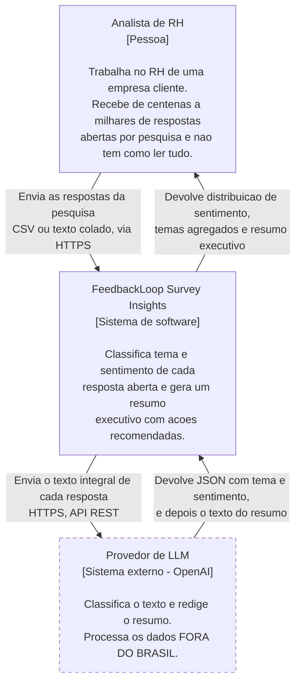
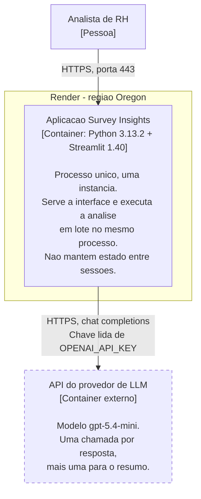
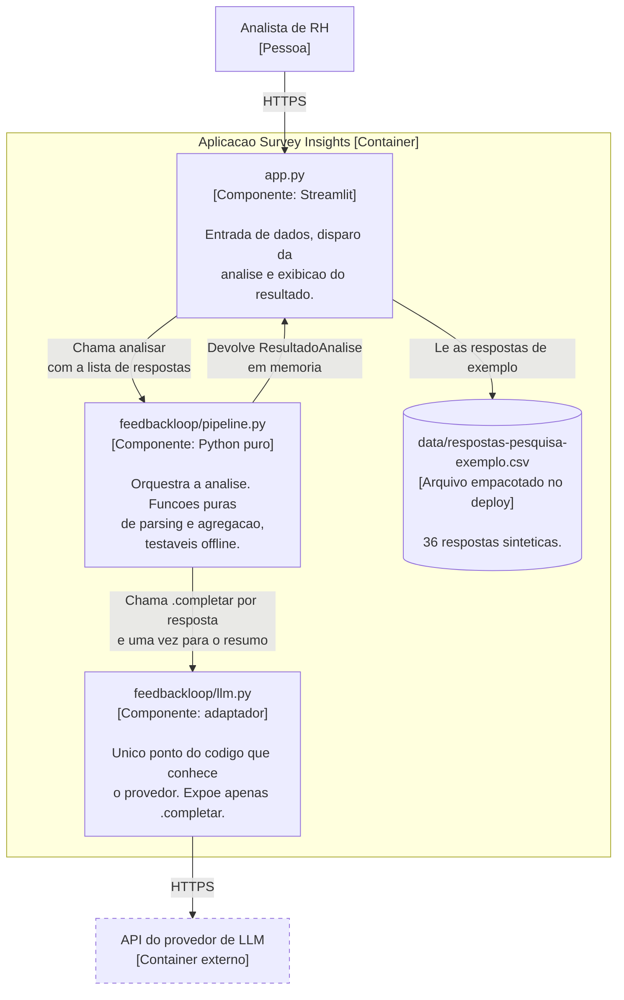
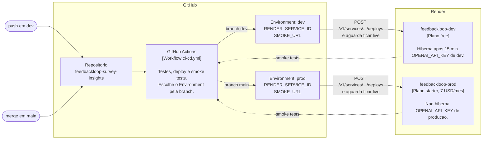

# Arquitetura: diagramas C4

Estes diagramas descrevem o sistema **como ele está publicado hoje**, e não como
eu gostaria que estivesse. Onde falta alguma coisa, a falta aparece desenhada.

Última verificação contra o ambiente real: 29/08/2026, produção rodando o commit
`45f6624` em `https://feedbackloop-prod.onrender.com`.

Notação em Mermaid, usando `flowchart` em vez da sintaxe C4 experimental do
Mermaid, porque o `flowchart` renderiza de forma confiável direto no GitHub. Os
níveis, os elementos e os rótulos seguem o modelo C4: cada caixa traz o nome, o
tipo, a tecnologia e a responsabilidade.

---

## Nível 1: Contexto

Quem usa o sistema, e com quem ele conversa.

**A fronteira que mais importa neste diagrama** é a seta que vai do sistema para
o provedor de LLM. As respostas de pesquisa de clima são dados de funcionários
das empresas clientes, contêm nomes de gestores e queixas identificáveis, e hoje
atravessam essa seta **sem nenhuma anonimização**. Como o provedor processa fora
do Brasil, cada análise é também uma transferência internacional de dados
pessoais, feita sem finalidade declarada e sem base legal registrada.

Está desenhado assim de propósito. É a lacuna 1 da
[auditoria](../auditoria-prototipo.md) e é o que impede o sistema de receber dado
real. Um diagrama que escondesse isso seria mais bonito e menos verdadeiro.

---

## Nível 2: Contêineres

As unidades que rodam separadamente e que precisam ser implantadas, escaladas ou
substituídas de forma independente.

### Por que este diagrama é tão pequeno

Ele tem um contêiner só, e isso é o retrato fiel do sistema, não falta de
detalhe. Não existe banco de dados, não existe fila, não existe serviço de
fundo. Tudo vive dentro de um único processo Python.

As consequências disso são concretas e estão documentadas nos outros artefatos:
o resultado da análise não sobrevive ao fechamento da aba, não há trilha de
auditoria do que foi enviado ao provedor, e o log do Render mostra
`WEB_CONCURRENCY=1`, então uma análise longa bloqueia o aplicativo para qualquer
outro visitante.

Um protótipo que nunca foi separado em contêineres é exatamente o que se espera
de código que nasceu para rodar na máquina de uma pessoa. Separar é trabalho das
etapas seguintes, e o desenho de hoje precisa mostrar o ponto de partida.

---

## Nível 3 (complementar): componentes dentro do contêiner

Fora do que a entrega pede, mas é aqui que se vê a melhor decisão da herança.

**O adaptador é a melhor herança do protótipo.** Todo o resto do código conhece
apenas o método `.completar`. É isso que torna os 7 testes offline possíveis sem
chamar a API, e é o que tornaria uma troca de provedor uma mudança localizada em
um arquivo em vez de uma reescrita. O
[ADR-001](../adr/adr-001-adocao-da-stack-b.md) apoia a decisão de manter a stack
justamente nessa separação.

**A fronteira de PII fica visível aqui.** O texto integral de cada resposta
percorre `app.py` para `pipeline.py` para `llm.py` e sai para fora do Brasil, sem
passar por nenhuma etapa de anonimização. Não existe componente entre o pipeline
e o adaptador, e é exatamente esse componente ausente que a lacuna 1 da
[auditoria](../auditoria-prototipo.md) descreve.

---

## Complementar: implantação e fluxo de publicação

Não faz parte dos níveis 1 e 2 do C4, mas sem ele o desenho não é fiel ao que
está no ar: existem **dois** ambientes, e a separação entre eles é o que sustenta
a operação.

O auto-deploy nativo do Render está **desligado** nos dois serviços. Quem publica
é o pipeline, e essa escolha está registrada no
[ADR-002](../adr/adr-002-hospedagem-no-render.md): uma plataforma que observa o
repositório não é integração contínua com entrega controlada, é publicação
automática, e as duas coisas falham de formas diferentes.

O mesmo arquivo de workflow atende os dois ambientes. O que muda é o GitHub
Environment escolhido pelo nome da branch, e com ele o serviço de destino e a
chave do provedor. Dev e prod nunca compartilham credencial.
