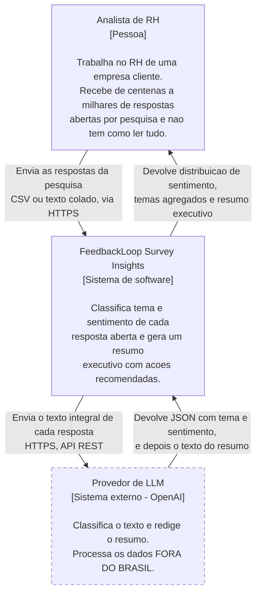
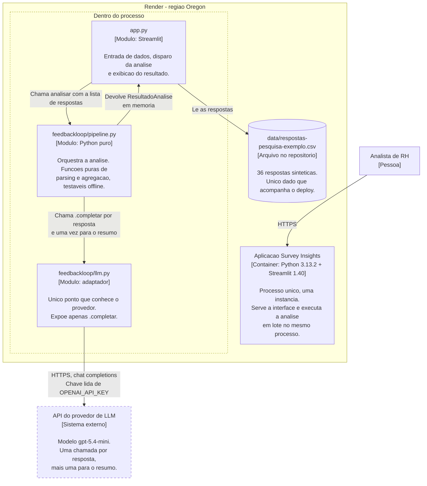

# Arquitetura: diagramas C4, níveis 1 e 2

Estes diagramas descrevem o sistema **como ele está publicado hoje**, e não como
eu gostaria que estivesse. Onde falta alguma coisa, a falta aparece desenhada.

Última verificação contra o ambiente real: 29/08/2026, produção rodando o commit
`45f6624` em `https://feedbackloop-prod.onrender.com`.

Notação em Mermaid, usando `flowchart` em vez da sintaxe C4 experimental do
Mermaid, porque o `flowchart` renderiza de forma confiável direto no GitHub. Os
níveis, os elementos e os rótulos seguem o modelo C4: cada caixa traz o nome, o
tipo, a tecnologia e a responsabilidade.

---

## Nível 1: Contexto

Quem usa o sistema, e com quem ele conversa.

**A fronteira que mais importa neste diagrama** é a seta que vai do sistema para
o provedor de LLM. As respostas de pesquisa de clima são dados de funcionários
das empresas clientes, contêm nomes de gestores e queixas identificáveis, e hoje
atravessam essa seta **sem nenhuma anonimização**. Como o provedor processa fora
do Brasil, cada análise é também uma transferência internacional de dados
pessoais, feita sem finalidade declarada e sem base legal registrada.

Está desenhado assim de propósito. É a lacuna 1 da
[auditoria](../auditoria-prototipo.md) e é o que impede o sistema de receber dado
real. Um diagrama que escondesse isso seria mais bonito e menos verdadeiro.

---

## Nível 2: Contêineres

O que existe dentro do sistema, e como as partes conversam.

### O que este nível revela

**Não existe banco de dados, e isso não é omissão do desenho.** O sistema não
persiste nada: o resultado vive no estado da sessão do Streamlit e desaparece
quando a aba fecha. Não há como comparar a pesquisa deste trimestre com a do
anterior, que é a promessa central de um produto de people analytics, e não há
trilha de auditoria do que foi enviado ao provedor. É a lacuna 2 da auditoria.

**Um processo, uma instância, execução síncrona.** O log do Render mostra
`WEB_CONCURRENCY=1`. A análise roda no mesmo processo que serve a interface, uma
resposta por vez. Com as 36 respostas de exemplo funciona; com as milhares que o
briefing menciona, uma análise longa bloqueia o aplicativo para qualquer outro
visitante. É a consequência negativa que o [ADR-001](../adr/adr-001-adocao-da-stack-b.md)
assume explicitamente.

**O adaptador é a melhor herança do protótipo.** Todo o resto do código conhece
apenas o método `.completar`. É isso que torna os testes possíveis sem chamar a
API, e é o que tornaria uma troca de provedor uma mudança localizada em um
arquivo em vez de uma reescrita.

---

## Complementar: implantação e fluxo de publicação

Não faz parte dos níveis 1 e 2 do C4, mas sem ele o desenho não é fiel ao que
está no ar: existem **dois** ambientes, e a separação entre eles é o que sustenta
a operação.

O auto-deploy nativo do Render está **desligado** nos dois serviços. Quem publica
é o pipeline, e essa escolha está registrada no
[ADR-002](../adr/adr-002-hospedagem-no-render.md): uma plataforma que observa o
repositório não é integração contínua com entrega controlada, é publicação
automática, e as duas coisas falham de formas diferentes.

O mesmo arquivo de workflow atende os dois ambientes. O que muda é o GitHub
Environment escolhido pelo nome da branch, e com ele o serviço de destino e a
chave do provedor. Dev e prod nunca compartilham credencial.
